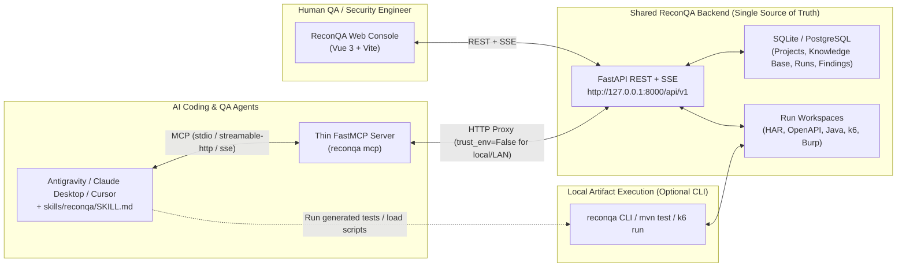

# AI Agent Integration (MCP Server & Agent Skill)

ReconQA ships a **zero-duplication AI Agent Collaboration Layer** built on the [Model Context Protocol (MCP)](https://modelcontextprotocol.io/) plus a portable open-source Agent Skill (`skills/reconqa/SKILL.md`).

Instead of maintaining a separate agent-only database or CLI wrapper, `reconqa mcp` acts as a thin proxy in front of the live ReconQA FastAPI + SQLite backend. Every project, Knowledge Base PRD, Explore session, analysis run, and finding created by an AI agent appears immediately in the Vue 3 Web Console for **Human-in-the-Loop** inspection and collaboration.

---

## 1. Architecture (Human-in-the-Loop Collaboration)



### Why This Design Works Well for Agents
- **Shared State**: Humans can paste PRDs or upload HARs in the Web Console, and agents immediately read them via MCP resources (`reconqa://projects/{project_id}/knowledge`, `reconqa://runs/{run_id}/openapi`).
- **Token-Efficient Responses**: Every MCP tool returns compact, bounded JSON summaries (top 40 endpoints on explore, bounded findings with truncated evidence, 300-char Knowledge Base excerpts)—never multi-megabyte raw HAR dumps.
- **Local/LAN Proxy Safety**: When `RECONQA_API_URL` points to `localhost`, `127.0.0.1`, private LAN IPs, `.local`, or Tailscale (`100.64.0.0/10`), the MCP client sets `trust_env=False` automatically so corporate/system `HTTP_PROXY` variables never hijack local API calls.

---

## 2. Quick Setup

### Install the MCP Extra
```bash
uv sync --extra mcp
```

### Start the ReconQA Backend
```bash
uv run reconqa serve --host 127.0.0.1 --port 8000
```

### Start the MCP Server
```bash
# Default stdio transport (recommended for local IDE/desktop agents)
uv run reconqa mcp --api-url http://127.0.0.1:8000

# Streamable HTTP transport (for shared/remote agent workflows)
uv run reconqa mcp --api-url http://127.0.0.1:8000 --transport streamable-http --host 127.0.0.1 --port 8001

# Legacy SSE transport
uv run reconqa mcp --api-url http://127.0.0.1:8000 --transport sse --host 127.0.0.1 --port 8001
```

You can also configure the backend URL via the `RECONQA_API_URL` environment variable (defaults to `http://127.0.0.1:8000`; `/api/v1` is appended automatically if omitted).

---

## 3. MCP Client Configuration Examples

Replace `/path/to/reconqa` with your local clone path (or use `reconqa` directly if installed globally).

### Antigravity (`mcp_config.json`)
```json
{
  "mcpServers": {
    "reconqa": {
      "command": "uv",
      "args": [
        "--directory",
        "/path/to/reconqa",
        "run",
        "reconqa",
        "mcp"
      ],
      "env": {
        "RECONQA_API_URL": "http://127.0.0.1:8000"
      }
    }
  }
}
```

### Claude Desktop (`claude_desktop_config.json`)
```json
{
  "mcpServers": {
    "reconqa": {
      "command": "uv",
      "args": [
        "--directory",
        "/path/to/reconqa",
        "run",
        "reconqa",
        "mcp",
        "--api-url",
        "http://127.0.0.1:8000"
      ]
    }
  }
}
```

### Cursor (`.cursor/mcp.json`)
```json
{
  "mcpServers": {
    "reconqa": {
      "command": "uv",
      "args": [
        "--directory",
        "/path/to/reconqa",
        "run",
        "reconqa",
        "mcp"
      ],
      "env": {
        "RECONQA_API_URL": "http://127.0.0.1:8000"
      }
    }
  }
}
```

### Remote / Streamable HTTP Mode
If your team runs ReconQA on an internal QA server (e.g. `http://qa-reconqa.example.com:8000`) and exposes the MCP server via `--transport streamable-http --host 0.0.0.0 --port 8001`:
```json
{
  "mcpServers": {
    "reconqa": {
      "url": "http://127.0.0.1:8001/mcp"
    }
  }
}
```

---

## 4. MCP Tools & Resources Reference

### Tools (14)

| Tool | Key Parameters | Purpose |
|---|---|---|
| `reconqa_list_projects` | _(none)_ | List all projects (`id`, `name`, `slug`, `description`, `created_at`). |
| `reconqa_create_project` | `name`, `description=""`, `root_domain=None`, `base_url=None` | Create a project and optionally register its initial target URL/domain. |
| `reconqa_list_knowledge` | `project_id`, `doc_type=None`, `q=None` | List/search project Knowledge Base docs with compact 300-char excerpts. |
| `reconqa_add_knowledge_doc` | `project_id`, `title`, `content`, `doc_type="prd"`, `tags=None`, `related_endpoints=None`, `external_url=None` | Save a PRD, API spec, business rule, or test note into the Knowledge Base. |
| `reconqa_explore_from_seed` | `seed_curl=None`, `target_url=None`, `mode="passive"`, `probe_openapi_docs=True`, `crawl_js=True` | Explore APIs, Swagger/OpenAPI docs, SPA/Webpack/Vite JS routes, and sibling hosts. Returns `explore_id` + compact summary + top 40 endpoints. |
| `reconqa_promote_explore_to_run` | `explore_id`, `project_id=None`, `project_name=None`, `modules=None`, `selected_endpoints=None` | Promote an Explore session into a testing run (defaults to fast `["merge"]`). |
| `reconqa_import_traffic_and_analyze` | `content`, `scenario="01_agent"`, `project_id=None`, `project_name=None`, `format="auto"` | Auto-resolve/create project from host or name, import cURL/fetch/Raw HTTP/HAR text, run `["merge"]`, wait up to 15s, and return compact summary. |
| `reconqa_upload_har_files` | `har_paths`, `project_id=None`, `project_name=None`, `scenario=None`, `wait=True` | Read one or more local `.har` files (or directories of `*.har`), auto-resolve/create project from primary HAR host or name, upload via multipart, run `["merge"]`, wait up to 20s, and return compact run summary + coverage %. |
| `reconqa_execute_run_modules` | `run_id`, `modules`, `config=None`, `wait=True` | Incrementally run `java_gen`, `perf`, `security`, or `merge` on an existing run and optionally poll up to 30s until complete. |
| `reconqa_get_run_summary` | `run_id` | Return run status, jobs, `summary_metrics`, coverage %, correlation chain count, available artifacts, and resource URIs. |
| `reconqa_list_findings` | `run_id`, `category=None`, `severity=None`, `limit=30` | Return severity-sorted findings with bounded evidence payloads (max 100 per call). |
| `reconqa_get_project_inventory` | `project_id`, `source=None`, `prefix=None`, `limit=80` | Fetch the project's cumulative Master API Inventory (`total_endpoints`, `har_live_count`, `js_static_count`, `coverage_pct`, `by_prefix`, `scenarios`, and filtered endpoints). |
| `reconqa_list_scenarios` | `project_id`, `priority=None`, `effectiveness_level=None` | List first-class business scenarios with `p0_p1_effective_pct`, `by_priority`, `by_effectiveness`, and per-scenario `L0`–`L4` effectiveness status. |
| `reconqa_upsert_scenario` | `project_id`, `slug`, `name=None`, `description=None`, `preconditions=None`, `business_domain=None`, `priority=None`, `status=None`, `owner=None`, `tags=None`, `assertions=None`, `negative_cases=None` | Upsert a business scenario (`source="ai-agent"`) with priority, business description, structured JSONPath assertions, and negative/edge test checklists. |

### Resources (3)

| Resource URI Template | MIME Type | Contents |
|---|---|---|
| `reconqa://runs/{run_id}/openapi` | `application/yaml` | Merged OpenAPI 3.0.3 YAML specification (`har-live`, `js-static-inferred`, `js-static`). |
| `reconqa://runs/{run_id}/correlation` | `application/json` | Mermaid data-flow graph, correlated producer->consumer variables, and request chains. |
| `reconqa://projects/{project_id}/knowledge` | `text/markdown` | Full Markdown digest of all PRDs, API specs, business rules, and notes for the project. |

---

## 5. Playbook: AI Browser Read-Only Roaming -> HAR -> ReconQA

Pair a browser-capable AI agent with ReconQA's scenario proxy (or browser HAR recording) to capture real `har-live` API schemas across every business module without writing a single brittle UI script:

1. **Start ReconQA's Scenario Proxy Recorder** (or configure your browser's native HAR capture):
   ```bash
   uv run reconqa record --mitm --port 8080 -o ./roam_hars --scenario 01_orders
   ```
   Route the agent's browser through `http://127.0.0.1:8080`.
2. **Follow Strict Read-Only Roaming Discipline**:
   - **Allowed**: Click navigation menus, module tabs, pagination, list filters, search queries, and read-only detail drawers/views.
   - **Forbidden**: NEVER click destructive or state-mutating controls (`Delete`, `Submit`, `Pay`, `Save`, `Approve`, `Reset Password`, `Disable`).
   - **Human-in-the-Loop Gate**: Stop and ask the human immediately whenever the app prompts for login, CAPTCHA, MFA/2FA, or SMS verification.
3. **Segment Traffic by Business Module**:
   Before entering each module, trigger a scenario switch so ReconQA saves clean per-module `.har` files:
   - `http://reconqa.local/scenario/01_orders` -> browse order lists & detail views
   - `http://reconqa.local/scenario/02_users` -> browse user directory & role pages
   - `http://reconqa.local/flush` -> flush the final HAR file cleanly to `./roam_hars/`
4. **Auto-Ingest via MCP**:
   Call `reconqa_upload_har_files(har_paths=["./roam_hars"], wait=True)`.
   - ReconQA automatically detects the primary host (e.g. `shop.example.com`), links or creates the project, extracts embedded JS bundles, merges all scenarios into **OpenAPI 3.0.3 + Data-Flow Correlations**, and computes **Coverage Diff** (`har-live` vs. static JS endpoints).
   - The new run appears immediately in the Vue 3 Web Console, ready for on-demand **Java TestNG+Allure (`java_gen`)**, **Performance & k6 (`perf`)**, or **Security & IDOR (`security`)** via `reconqa_execute_run_modules` or the Web UI tabs.
5. **Effectiveness Loop (Beyond HTTP 200)**:
   - Read Project Knowledge Base PRDs (`reconqa://projects/{project_id}/knowledge`), inspect the cumulative Master API Inventory (`reconqa_get_project_inventory`), and call `reconqa_list_scenarios(project_id)` to spot `P0`/`P1` business scenarios stuck at `L1`/`L2`.
   - Call `reconqa_upsert_scenario(project_id, slug=..., priority="P0", assertions=[...], negative_cases=[...])` to enrich those scenarios with structured JSONPath business assertions and negative/edge test checklists—ReconQA then compiles real business checks directly into generated Java RestAssured tests!

---

## 6. Installing the Open-Source Agent Skill (`skills/reconqa/SKILL.md`)

`skills/reconqa/SKILL.md` teaches AI agents ReconQA's recommended workflow (explore-first discovery, Knowledge Base grounding, progressive on-demand module execution, safe dynamic A/B IDOR verification with cleanup, and strict secret hygiene).

### Install into Your Agent Workspace
Copy or symlink `skills/reconqa/` into your agent's skills directory:

```bash
# Antigravity / Gemini CLI user skills
mkdir -p ~/.gemini/config/skills
ln -s /path/to/reconqa/skills/reconqa ~/.gemini/config/skills/reconqa

# Project-local Claude Code / Codex / Cursor skills
mkdir -p .agents/skills
cp -r /path/to/reconqa/skills/reconqa .agents/skills/reconqa
```

### Example Prompt
Once both the MCP server and `SKILL.md` are active, you can prompt your agent directly:

> "Use ReconQA to explore `https://shop.example.com` from this DevTools cURL, save the checkout business rules we discussed to the project's Knowledge Base, promote the discovered `/api/v1/orders` endpoints to a run, and generate the Java TestNG suite plus a static security audit."

Everything the agent executes will appear live in your ReconQA Web Console for review, editing, and artifact download.
