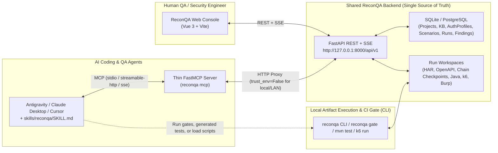

# AI Agent Integration (MCP Server & Agent Skill)

ReconQA ships a **zero-duplication AI Agent Collaboration Layer** built on the [Model Context Protocol (MCP)](https://modelcontextprotocol.io/) plus a portable open-source Agent Skill (`skills/reconqa/SKILL.md`).

Instead of maintaining a separate agent-only database or CLI wrapper, `reconqa mcp` acts as a thin proxy in front of the live ReconQA FastAPI + SQLite/PostgreSQL backend. Every project, Knowledge Base PRD, Auth Profile, Explore session, analysis run, chain run, scenario, and finding created by an AI agent appears immediately in the Vue 3 Web Console for **Human-in-the-Loop** inspection and collaboration.

---

## 1. Architecture (Human-in-the-Loop Collaboration)



### Why This Design Works Well for Agents
- **Shared State**: Humans can paste PRDs or upload HARs in the Web Console, and agents immediately read them via all **3 MCP resources**: `reconqa://projects/{project_id}/knowledge`, `reconqa://runs/{run_id}/openapi`, and `reconqa://runs/{run_id}/correlation`.
- **Token-Efficient Responses**: Every MCP tool returns compact, bounded JSON summaries (top 40 endpoints on explore, bounded findings with truncated evidence, 4KB replay truncation, 300-char Knowledge Base excerpts)—never multi-megabyte raw HAR dumps.
- **Zero-Secret Credential Handling**: `reconqa_list_auth_profiles` and `reconqa_extract_credential` return `profile_id` and header names only, injecting credentials server-side during explore, replay, and chain execution.
- **Local/LAN Proxy Safety**: When `RECONQA_API_URL` points to `localhost`, `127.0.0.1`, private LAN IPs, `.local`, or Tailscale (`100.64.0.0/10`), the MCP client sets `trust_env=False` automatically so corporate/system `HTTP_PROXY` variables never hijack local API calls.

---

## 2. Quick Setup

### Install the MCP Extra
```bash
uv sync --extra mcp
```

### Start the ReconQA Backend
```bash
uv run reconqa serve --host 127.0.0.1 --port 8000
```

### Start the MCP Server
```bash
# Default stdio transport (recommended for local IDE/desktop agents)
uv run reconqa mcp --api-url http://127.0.0.1:8000

# Streamable HTTP transport (for shared/remote agent workflows)
uv run reconqa mcp --api-url http://127.0.0.1:8000 --transport streamable-http --host 127.0.0.1 --port 8001

# Legacy SSE transport
uv run reconqa mcp --api-url http://127.0.0.1:8000 --transport sse --host 127.0.0.1 --port 8001
```

You can also configure the backend URL via the `RECONQA_API_URL` environment variable (defaults to `http://127.0.0.1:8000`; `/api/v1` is appended automatically if omitted).

---

## 3. MCP Client Configuration Examples

Replace `/path/to/reconqa` with your local clone path (or use `reconqa` directly if installed globally).

### Antigravity (`mcp_config.json`)
```json
{
  "mcpServers": {
    "reconqa": {
      "command": "uv",
      "args": [
        "--directory",
        "/path/to/reconqa",
        "run",
        "reconqa",
        "mcp"
      ],
      "env": {
        "RECONQA_API_URL": "http://127.0.0.1:8000"
      }
    }
  }
}
```

### Claude Desktop (`claude_desktop_config.json`)
```json
{
  "mcpServers": {
    "reconqa": {
      "command": "uv",
      "args": [
        "--directory",
        "/path/to/reconqa",
        "run",
        "reconqa",
        "mcp",
        "--api-url",
        "http://127.0.0.1:8000"
      ]
    }
  }
}
```

### Cursor (`.cursor/mcp.json`)
```json
{
  "mcpServers": {
    "reconqa": {
      "command": "uv",
      "args": [
        "--directory",
        "/path/to/reconqa",
        "run",
        "reconqa",
        "mcp"
      ],
      "env": {
        "RECONQA_API_URL": "http://127.0.0.1:8000"
      }
    }
  }
}
```

### Remote / Streamable HTTP Mode
If your team runs ReconQA on an internal QA server (e.g. `http://qa-reconqa.example.com:8000`) and exposes the MCP server via `--transport streamable-http --host 0.0.0.0 --port 8001`:
```json
{
  "mcpServers": {
    "reconqa": {
      "url": "http://127.0.0.1:8001/mcp"
    }
  }
}
```

---

## 4. MCP Tools & Resources Reference

### Tools (22)

| Tool | Exact Parameters & Defaults | Purpose |
|---|---|---|
| `reconqa_list_projects` | _(none)_ | List all projects (`id`, `name`, `slug`, `description`, `created_at`). |
| `reconqa_create_project` | `name`, `description=""`, `root_domain=None`, `base_url=None` | Create a project and optionally register its initial target URL/domain. |
| `reconqa_list_knowledge` | `project_id`, `doc_type=None`, `q=None` | List/search project Knowledge Base docs with compact 300-char excerpts. |
| `reconqa_add_knowledge_doc` | `project_id`, `title`, `content`, `doc_type="prd"`, `tags=None`, `related_endpoints=None`, `external_url=None` | Save a PRD, API spec, business rule, or test note into the Knowledge Base. |
| `reconqa_list_auth_profiles` | `project_id` | List saved project `AuthProfile` entries with masked metadata only (`id`, `name`, `role_tag`, `auth_type`, `has_storage_state`, `header_names`, `login_url`, `username`) — zero raw secrets. |
| `reconqa_explore_from_seed` | `seed_curl=None`, `target_url=None`, `mode="passive"`, `probe_openapi_docs=True`, `crawl_js=True`, `project_id=None`, `credential_id=None`, `auth=None` | Explore APIs, Swagger/OpenAPI docs, SPA/Webpack/Vite JS routes, and sibling hosts with optional saved `credential_id` or inline `auth` (8 modes, `scope_domains`, `save_as_profile`). Returns `explore_id` + `seed` + top 40 endpoints. |
| `reconqa_promote_explore_to_run` | `explore_id`, `project_id=None`, `project_name=None`, `modules=None`, `selected_endpoints=None` | Promote an Explore session into a testing run (defaults to fast `["merge"]`). |
| `reconqa_import_traffic_and_analyze` | `content`, `scenario="01_agent"`, `project_id=None`, `project_name=None`, `format="auto"` | Auto-resolve/create project from host or name, import cURL/fetch/Raw HTTP/HAR text, run `["merge"]`, wait up to 15s, and return compact summary. |
| `reconqa_upload_har_files` | `har_paths`, `project_id=None`, `project_name=None`, `scenario=None`, `wait=True` | Read one or more local `.har` files (or directories of `*.har`), auto-resolve/create project, upload via multipart, run `["merge"]`, wait up to 20s, and return compact summary + coverage %. |
| `reconqa_execute_run_modules` | `run_id`, `modules`, `config=None`, `wait=True` | Incrementally run `java_gen`, `perf`, `security`, or `merge` on an existing run and optionally poll up to 30s until complete. |
| `reconqa_get_run_summary` | `run_id` | Return run status, jobs, `summary_metrics`, coverage %, correlation chain count, available artifacts, and resource URIs. |
| `reconqa_list_findings` | `run_id`, `category=None`, `severity=None`, `limit=30` | Return severity-sorted findings with bounded evidence payloads (clamped `1..100`). |
| `reconqa_get_project_inventory` | `project_id`, `source=None`, `prefix=None`, `limit=80` | Fetch the project's cumulative Master API Inventory (`total_endpoints`, `har_live_count`, `js_static_count`, `coverage_pct`, `by_prefix`, `scenarios`, and filtered endpoints, clamped `1..200`). |
| `reconqa_get_capability_map` | `project_id`, `live_only=True`, `module=None`, `role=None`, `has_writes=False`, `limit=30` | Fetch the synthesized Business Capability Map (`Resource × Action × Role × State`) with 5-dimensional QA metrics, module breakdown, observed state enums, 5-slot case matrix, and up to 8 sample endpoint paths per capability. |
| `reconqa_promote_capability_scenario` | `project_id`, `capability_key`, `priority=None`, `name=None` | Materialize a 5-case effectiveness `Scenario` (Happy Path + Invalid Params + Illegal State + AuthZ/Role + Consistency/Idempotency) cleanly and idempotently. |
| `reconqa_list_scenarios` | `project_id`, `priority=None`, `effectiveness_level=None` | List first-class business scenarios with `p0_p1_effective_pct`, `by_priority`, `by_effectiveness`, and per-scenario `L0`–`L4` effectiveness status. |
| `reconqa_upsert_scenario` | `project_id`, `slug`, `name=None`, `description=None`, `preconditions=None`, `business_domain=None`, `priority=None`, `status=None`, `owner=None`, `tags=None`, `assertions=None`, `negative_cases=None` | Upsert a business scenario (`source="ai-agent"`) with priority, business description, structured 23-operator assertions, and negative/edge test checklists. |
| `reconqa_extract_credential` | `project_id`, `run_id=None`, `name=None`, `role_tag="account_a"` | Auto-extract auth headers from a run's HAR into a project `AuthProfile` and return `{ profile_id, name, role_tag, extracted_header_names, source_run_id, source_host }` without echoing raw secrets. |
| `reconqa_replay_endpoint` | `project_id`, `method`, `url`, `headers=None`, `query_params=None`, `body=None`, `credential_id=None`, `timeout_sec=15.0`, `assertions=None`, `include_scenario_assertions=True`, `sync_scenarios=True`, `db_dsn_ref=None`, `context_vars=None` | Safely replay an HTTP endpoint with optional `AuthProfile` injection, 4KB truncation, dynamic placeholder resolution, 23-operator assertions, and automatic Scenario L3 writeback (`synced_scenarios`, `synced_assertions`). |
| `reconqa_run_external_tool` | `project_id`, `run_id`, `tool`, `credential_id=None`, `base_url=None`, `sync_scenarios=True`, `timeout_sec=120` | Run `java_test`, `schemathesis`, `nuclei`, or `k6` against a run and automatically sync assertion / negative-case pass/fail status back into project Scenarios (`L0`–`L4`). |
| `reconqa_execute_chain` | `project_id`, `run_id=None`, `chain_name=None`, `chain_index=None`, `steps=None`, `base_url=None`, `credential_id=None`, `initial_vars=None`, `step_assertions=None`, `include_scenario_assertions=True`, `sync_scenarios=True`, `db_dsn_ref=None`, `stop_on_failure=True` | Execute a multi-step API chain with dynamic variables, deep assertions, checkpoint persistence (`chain_run_id`), and automatic Scenario L3 writeback (`synced_scenarios`, `synced_assertions`). |
| `reconqa_resume_chain` | `project_id`, `chain_run_id`, `from_step_index=None`, `override_vars=None`, `override_step_body=None`, `override_step_assertions=None`, `credential_id=None`, `db_dsn_ref=None`, `sync_scenarios=True` | Resume a failed or partial chain run from its checkpoint step (`from_step_index`) without re-running prior passed steps, syncing updated assertion results to Scenarios. |

### Resources (3)

| Resource URI Template | MIME Type | Contents |
|---|---|---|
| `reconqa://runs/{run_id}/openapi` | `application/yaml` | Merged OpenAPI 3.0.3 YAML specification (`har-live`, `openapi-doc`, `js-static-inferred`, `js-static`). |
| `reconqa://runs/{run_id}/correlation` | `application/json` | Mermaid data-flow graph, correlated producer->consumer variables, and request chains. |
| `reconqa://projects/{project_id}/knowledge` | `text/markdown` | Full Markdown digest of all PRDs, API specs, business rules, and notes for the project. |

### Assertion Operators, Dynamic Placeholders & GraphQL Virtual Endpoints

- **23 `ScenarioAssertionOperator` operators** (22 executable + `custom`):
  - *Equality / Presence*: `equals`, `not_equals`, `not_empty`, `is_empty`
  - *Numeric*: `gt`, `gte`, `lt`, `lte`
  - *String / Collection / Type*: `contains`, `not_contains`, `matches`, `array_contains`, `length_eq`, `length_gt`, `type_is`
  - *HTTP Contract & SLA*: `status_code` (`200`, `200,201`, or `2xx`), `header_equals`, `latency_lt`, `json_schema` (blocks external `$ref` SSRF)
  - *Cross-Step Variable / Arithmetic*: `var_equals` (supports `{{var}}` and safe AST `Decimal` `+ - * /` arithmetic)
  - *Read-Only SQL*: `sql_equals`, `sql_exists` — requires `db_dsn_ref` in `ENV:RECONQA_*` or `${RECONQA_*}` form (explicitly forbids `RECONQA_DATABASE_URL` and ReconQA's own DB), enforces a single `SELECT` statement with bound `{{var}}` parameters, read-only dialect sessions, and a 50-row cap
  - *Manual Note*: `custom`
- **4 Built-In Dynamic Placeholders**: `{{$timestamp}}` (UTC epoch seconds `int`), `{{$uuid}}` (UUIDv4 string), `{{$randInt(min,max)}}` (inclusive random `int`), and `{{$isoDate}}` (UTC ISO-8601 `...Z` string). Exact `"{{$timestamp}}"` / `"{{$randInt(min,max)}}"` JSON field values preserve native integer types in `chain_runner` and `/replay`.
- **GraphQL Virtual Endpoints**: HAR/OpenAPI ingestion splits GraphQL operations into `POST /graphql#<OperationName>` (e.g. `POST /graphql#GetOrderList`). Keep the `#<OperationName>` suffix when matching Inventory/Capabilities/Scenarios; `reconqa_replay_endpoint` and `reconqa_execute_chain` automatically strip `#...` before sending HTTP requests over the wire.

---

## 5. Playbook: Authenticated Exploration & Read-Only Roaming -> HAR -> Zero-JDK L0→L4 Acceptance

Pair a browser-capable or MCP-driven AI agent with ReconQA to map authenticated systems and drive end-to-end acceptance without writing brittle scripts:

1. **Authenticated Discovery & Pre-Flight Checks**:
   - Check existing credentials via `reconqa_list_auth_profiles(project_id)` before asking humans for tokens.
   - When supplying inline auth (`headers`, `bearer`, `cookie`, `basic`, `login_api`, `form_login`) or Burp-pasted headers, verify credentials pre-flight with `POST /api/v1/explore/verify-auth` and restrict `scope_domains` so credentials never leak across cross-domain `3xx` redirects.
   - Or start ReconQA's Scenario Proxy Recorder (`uv run reconqa record --mitm --port 8080 -o ./roam_hars --scenario 01_orders`) with a saved Playwright `storage_state` if available.
2. **Follow Strict Read-Only Roaming Discipline**:
   - **Allowed**: Click navigation menus, module tabs, pagination, list filters, search queries, and read-only detail drawers/views.
   - **Forbidden**: NEVER click destructive or state-mutating controls (`Delete`, `Submit`, `Pay`, `Save`, `Approve`, `Reset Password`, `Disable`).
   - **Human-in-the-Loop Gate**: Stop and ask the human immediately whenever the app prompts for login, CAPTCHA, MFA/2FA, or SMS verification.
3. **Segment Traffic by Business Module**:
   Before entering each module, trigger a scenario switch so ReconQA saves clean per-module `.har` files:
   - `http://reconqa.local/scenario/01_orders` -> browse order lists & detail views
   - `http://reconqa.local/scenario/02_users` -> browse user directory & role pages
   - `http://reconqa.local/flush` -> flush the final HAR file cleanly to `./roam_hars/`
4. **Auto-Ingest via MCP**:
   Call `reconqa_upload_har_files(har_paths=["./roam_hars"], wait=True)`.
   - ReconQA detects the primary host, splits GraphQL calls into `POST /graphql#<OperationName>`, extracts embedded JS bundles, merges all scenarios into **OpenAPI 3.0.3 + Data-Flow Correlations**, and computes **Coverage Diff**.
5. **Zero-JDK Online L0→L4 Loop (Plus Optional External Tools)**:
   - Extract session credentials without exposing tokens to the LLM via `reconqa_extract_credential(project_id, run_id=...)` -> returns `profile_id` and header names only.
   - Compress endpoints with `reconqa_get_capability_map(project_id, live_only=True)`, then materialize 5-case scenarios via `reconqa_promote_capability_scenario(project_id, capability_key=...)`.
   - Read Project Knowledge Base PRDs (`reconqa://projects/{project_id}/knowledge`), inspect `reconqa_list_scenarios(project_id)`, and refine 23-operator assertions + dynamic `{{$...}}` placeholders via `reconqa_upsert_scenario(...)`.
   - **Fast Zero-JDK Verification**: Run `reconqa_replay_endpoint(project_id, ..., credential_id=profile_id, sync_scenarios=True)` and `reconqa_execute_chain(project_id, run_id=..., chain_index=0, credential_id=profile_id, sync_scenarios=True)` (recovering from failed steps with `reconqa_resume_chain(..., from_step_index=..., override_vars=..., sync_scenarios=True)`). Assertion pass/fail results write back directly to `ScenarioModel` (`L3` status) without needing `mvn test` or a JDK.
   - **Optional External Verifiers**: When deeper compiled/fuzz/load checks are needed, call `reconqa_run_external_tool(project_id, run_id, tool="java_test" | "schemathesis" | "nuclei" | "k6", credential_id=profile_id, sync_scenarios=True)`.
6. **Deliverable Exports & Quality Gate Enforcement**:
   - Export standalone HTML/Markdown acceptance reports (`GET /api/v1/projects/{project_id}/acceptance-report?format=html|markdown|json`) and Postman v2.1 collections (`GET /api/v1/projects/{project_id}/export/postman`).
   - Enforce release readiness with `uv run reconqa gate --project-id <project_id> --api-url http://127.0.0.1:8000` (or `POST /api/v1/projects/{project_id}/gate`), exiting `0` only when P0 chains, security findings, coverage diff, and P95 thresholds pass.

---

## 6. Installing the Open-Source Agent Skill (`skills/reconqa/SKILL.md`)

`skills/reconqa/SKILL.md` teaches AI agents ReconQA's recommended workflow (authenticated explore-first discovery, Knowledge Base grounding, Zero-JDK L0→L4 verification, progressive on-demand module execution, safe dynamic A/B IDOR verification with cleanup, quality gating, and strict secret hygiene).

### Install into Your Agent Workspace
Copy or symlink `skills/reconqa/` into your agent's skills directory:

```bash
# Antigravity / Gemini CLI user skills
mkdir -p ~/.gemini/config/skills
ln -s /path/to/reconqa/skills/reconqa ~/.gemini/config/skills/reconqa

# Project-local Claude Code / Codex / Cursor skills
mkdir -p .agents/skills
cp -r /path/to/reconqa/skills/reconqa .agents/skills/reconqa
```

### Example Prompt
Once both the MCP server and `SKILL.md` are active, you can prompt your agent directly:

> "Use ReconQA to check saved auth profiles, explore `https://shop.example.com` from this DevTools cURL, save the checkout business rules to the Knowledge Base, promote the core `/api/v1/orders` capability into a 5-case scenario, execute the correlation chain with `sync_scenarios=True` to reach L3, and run `reconqa gate` plus export the Markdown acceptance report."

Everything the agent executes will appear live in your ReconQA Web Console for review, editing, and artifact download.
