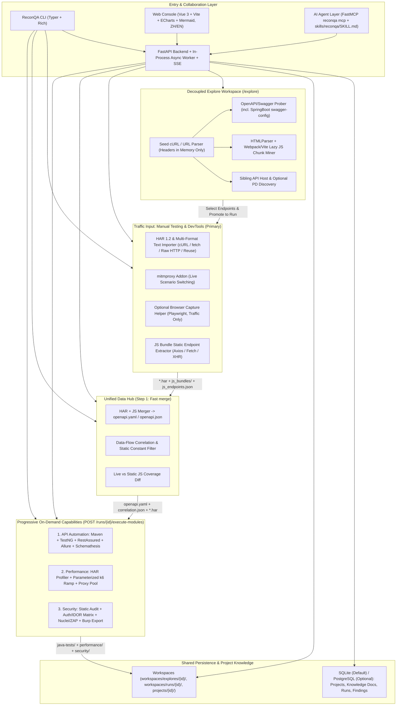
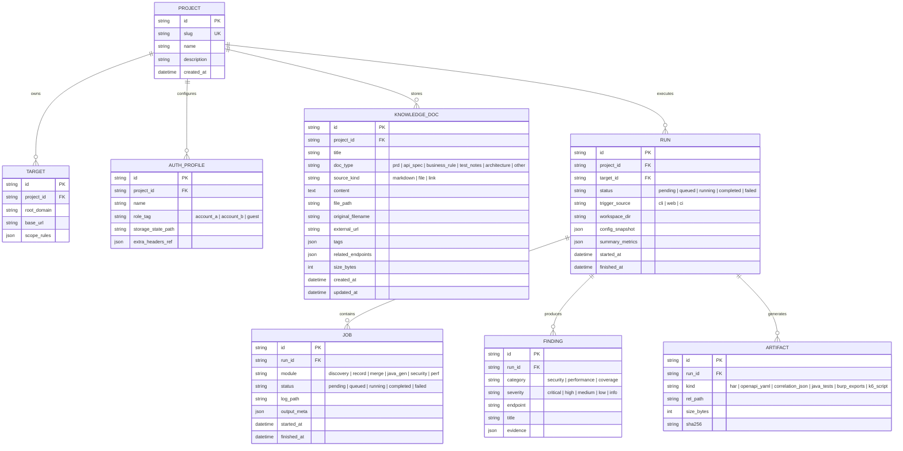

# ReconQA Architecture & Core Contracts

ReconQA is a **"one-recording, multi-use"** Web/API testing platform built around a single file-contract hub (**HAR 1.2 + OpenAPI 3.0.3**). Starting from manual testing traffic, DevTools exports (`HAR 1.2`, Chrome DevTools `Copy as cURL` / `Copy as fetch`, Burp/Charles `Raw HTTP`, `mitmproxy`), or a decoupled **Explore from Seed cURL** session, ReconQA builds a unified API & correlation hub that progressively drives **three core testing capabilities**:

1. **API Automation** (`Maven` + `TestNG 7.10` + `RestAssured 5.5` + `Allure 2.29` + `JSON Schema Draft-07` + optional `Schemathesis`)
2. **Performance Testing** (HAR bottleneck profiler, parameterized ramping `k6` scripts, optional local round-robin proxy pool)
3. **Security Testing** (static headers/cookies/redacted leaks, unauthenticated replay & read-only-by-default privilege/IDOR checks, optional Nuclei/ZAP, Burp `.http` + cURL export)

Both human testers (via the bilingual Vue 3 Web Console or CLI) and AI agents (via the thin FastMCP server `reconqa mcp` + `skills/reconqa/SKILL.md`) share the same FastAPI server, SQLite/PostgreSQL database, Project Knowledge Base, and workspace artifacts.

---

## 1. System Architecture



### Key Architectural Principles

- **Explore Decoupled from Testing**: `/explore` operates independently of test runs (`workspaces/explores/{explore_id}/`). A tester or AI agent pastes one seed cURL (headers are used in memory for probing and never persisted in plaintext; only header names are stored in `auth_headers_detected`), discovers OpenAPI/Swagger specs (including SpringBoot `/v3/api-docs/swagger-config` and `/swagger-resources`), mines unquoted HTML `<script>` / `<link rel="modulepreload">` and Webpack/Vite lazy JS chunks (skipping vendor libraries like ElementUI/ECharts/Monaco), identifies sibling API hosts on the same registrable root domain, and selectively promotes discovered endpoints into a full Run via `POST /api/v1/explore/{explore_id}/promote-to-run`.
- **Multi-Format DevTools Input**: Accepts `.har` uploads (Chrome DevTools, Charles, Fiddler, mitmproxy, Playwright), pasted **Copy as cURL** / **Copy all as cURL** (POSIX `$'...'` & bash/Windows quoting), **Copy as fetch**, Burp/Charles **Raw HTTP**, pasted **HAR 1.2 JSON**, and SHA-256 deduplicated historical HAR reuse.
- **Progressive On-Demand Execution**: Creating a run from the Web Console runs fast core Hub analysis (`["merge"]`) first so OpenAPI, correlation chains, and coverage diff appear in seconds. Heavy capability modules (`java_gen`, `perf`, `security`) are then triggered incrementally on demand from their respective tabs via `POST /api/v1/runs/{run_id}/execute-modules`. If a configured `target_domain` matches zero HAR entries, the pipeline automatically falls back to analyzing all HAR hosts with an informative warning rather than silently returning 0 endpoints.
- **File-Contract Decoupling**: Modules exchange standard artifacts (`HAR 1.2`, `OpenAPI 3.0.3`, `JSON`, `JSONL`, `Mermaid`). Every stage works standalone via CLI or orchestrated through FastAPI + `TaskRunner`.
- **Human-in-the-Loop AI Agent Collaboration**: The MCP server (`reconqa mcp`) is a thin FastMCP client over ReconQA's REST API rather than a separate state store. Any project, knowledge doc, explore session, or test run created by an AI agent appears immediately in the Web Console, and vice versa.
- **Standalone Tool Distribution**: External CLI tools are resolved via `RECONQA_BIN_DIR` → `~/.reconqa/bin` → `./bin` → current Python venv → `PATH`, bootstrapped via `scripts/install-tools.sh [--only <tool>]`, inspected via `reconqa doctor` / `GET /api/v1/system/doctor`, and installable from the Web UI for safe allowlisted user-space tools (`POST /api/v1/system/doctor/install`).
- **Three-Tier Discovery Provenance (`x-discovery-source`)**:
  - `har-live`: Observed live request/response schemas, headers, and latency baselines from HAR traffic.
  - `js-static-inferred`: Endpoints discovered in JS bundles with statically inferred HTTP method and request/response field hints.
  - `js-static`: Path-only endpoints extracted from JS bundles to highlight coverage blind spots.

---

## 2. Relational Data Model

ReconQA uses SQLAlchemy 2.0 async ORM (`backend/reconqa/models/tables.py`) supporting SQLite (zero-config default) and PostgreSQL:



> **Credential Safety**: `AUTH_PROFILE` stores references to managed `storage_state.json` files or header metadata; `explore_result.json` strips raw header values; generated Java tests, OpenAPI examples, and security reports never hardcode raw secrets, tokens, or PII.

---

## 3. Unified Data Hub Contracts

### 3.1 OpenAPI 3.0.3 Vendor Extensions (`hub/openapi.yaml`)

Every generated operation is enriched with:

| Extension | Purpose |
| :--- | :--- |
| `x-discovery-source` | Provenance priority: `har-live` > `js-static-inferred` > `js-static` |
| `x-scenarios` | Recording scenario names where the endpoint appeared (mapped to Allure `@Feature`) |
| `x-custom-headers` | Non-standard business header templates (auth values redacted) |
| `x-js-snippet` | Truncated static JS code context and source bundle name |
| `x-perf-baseline` | Observed latency & payload stats: `{count, p50_ms, p95_ms, avg_bytes}` |
| `x-biz-success` | Business success predicate inferred from 2xx responses (e.g. `{"field": "code", "value": 0}`) or overridden via `reconqa.yaml` |
| `x-requires-auth` | Boolean flag indicating authenticated baseline traffic (drives L3 auth boundary tests) |

### 3.2 Data-Flow Correlation Contract (`hub/correlation.json`)

```json
{
  "variables": [
    {
      "var_name": "itemId",
      "producer": {
        "step": 1,
        "scenario": "01_browse_search",
        "method": "GET",
        "path": "/api/v1/items/search",
        "jsonpath": "$.data.list[0].id",
        "sample": "ITEM-88421"
      },
      "consumers": [
        {
          "step": 2,
          "scenario": "02_detail_cart",
          "method": "GET",
          "path": "/api/v1/items/{itemId}",
          "location": "path",
          "param": "itemId"
        }
      ],
      "confidence": 0.94,
      "filtered_reason": null
    }
  ],
  "chains": [
    {
      "name": "DetailCartChain",
      "scenario": "02_detail_cart",
      "steps": [],
      "cleanup_step": {
        "method": "DELETE",
        "path": "/api/v1/cart/items/{cartItemId}"
      }
    }
  ],
  "filtered_constants": ["TENANT_STATIC_999"],
  "mermaid": "flowchart LR\n  ..."
}
```

**Pseudo-Dependency Filtering**:
- Discards short values (`< 4` chars), booleans/common status tokens (`true`, `false`, `null`, `ok`, `success`, `0`, `200`), URLs/paths, pure date strings, and high-frequency static constants appearing in `> 60%` of responses (recorded in `filtered_constants`).
- Boosts confidence when producer/consumer field names carry identifier semantics (`*id`, `*no`, `*token`, `*code`, `*sku`, `*order`, `*cart`).
- Automatically identifies `cleanup_step` when a `DELETE` or `delete/remove/cancel/clear` operation consumes the same resource identifier.

---

## 4. Generated Java Maven Project Layout (`java-tests/`)

```text
java-tests/
├── pom.xml                                       # Java 21 (configurable), TestNG 7.10.2, RestAssured 5.5.0, Jackson, OpenCSV, Allure 2.29.0, AspectJ weaver
├── testng.xml                                    # Registers TestExecutionListener + L1_Smoke / L2_Chain / L3_Security suites
└── src/test/
    ├── resources/
    │   ├── config.properties                     # base.uri / auth placeholders (ENV vars take precedence)
    │   ├── allure.properties                     # allure.results.directory=target/allure-results
    │   ├── logback-test.xml
    │   ├── data/
    │   │   ├── l1_smoke_endpoints.csv            # L1 @DataProvider table referencing externalized JSON param/payload paths
    │   │   └── params/                           # Externalized query/header JSON files
    │   ├── payloads/<scenario>/<op>.json         # Externalized request bodies with ${varName} placeholders
    │   └── schemas/<op>.json                     # JSON Schema Draft-07 converted from OpenAPI 3.0.3
    └── java/com/reconqa/generated/
        ├── base/ApiBaseTest.java                 # @BeforeClass CookieFilter, RequestSpecBuilder, AllureRestAssured, sendRequest, sendUnauthenticatedRequest, performStandardValidations
        ├── util/ConfigUtils.java                 # RECONQA_BASE_URI / RECONQA_AUTH_TOKEN / RECONQA_AUTH_COOKIE env-first loader
        ├── util/JsonUtils.java                   # External JSON loader & ${varName}/ObjectNode replacement
        ├── util/CsvUtils.java                    # OpenCSV TestNG @DataProvider reader
        ├── util/ReportUtils.java                 # UTF-8 byte-safe Allure response attachments
        ├── listener/TestExecutionListener.java   # Writes target/reconqa-execution-summary.json on suite finish
        ├── smoke/L1SmokeContractTest.java        # L1 read-only CSV + JSON-path contract smoke + Draft-07 schema + latency checks
        ├── chains/L2*ChainTest.java              # L2 dependsOnMethods + @Step + GPath extraction + @AfterClass teardown (or createdResources TODO hook)
        └── security/L3AuthBoundaryTest.java      # L3 unauthenticated replay expecting HTTP 401/403 or non-success bizCode
```

---

## 5. CLI & FastAPI REST / SSE Surface

### 5.1 CLI Commands (`backend/reconqa/cli.py`)

| Command | Key Options | Responsibility |
| :--- | :--- | :--- |
| `reconqa init` | `-o reconqa.yaml`, `--force` | Generate a starter `reconqa.yaml` project configuration |
| `reconqa doctor` | — | Check availability of 14 external tools (`subfinder`, `urlfinder`, `tlsx`, `katana`, `httpx`, `nuclei`, `k6`, `mvn`, `allure`, `mitmdump`, `playwright`, `schemathesis`, `java`, `docker`) |
| `reconqa discover` | `target`, `--mode passive\|active`, `--depth`, `--crawl-time`, `-o` | Passive or active asset discovery + SPA route extraction |
| `reconqa record` | `[url]`, `--interactive/--auto`, `--mitm`, `--port`, `--scenario`, `--storage-state`, `--save-storage-state`, `--domain`, `-o` | Multi-scenario `mitmproxy` proxy recorder or optional local Playwright traffic capture |
| `reconqa import-har` | `sources...`, `--scenario`, `--domain`, `-o` | Normalize Chrome/Charles/Fiddler/Playwright HARs and extract embedded JS bundles |
| `reconqa import-text` | `[source\|-]`, `--scenario`, `--format auto\|curl\|fetch\|raw_http\|har_json`, `--domain`, `-o` | Convert pasted Chrome DevTools `Copy as cURL`, `Copy as fetch`, Raw HTTP, or HAR JSON into HAR 1.2 |
| `reconqa merge` | `--run-dir`, `--domain`, `--config` | Build OpenAPI 3.0.3, data-flow correlation graph, and JS coverage diff |
| `reconqa gen-java` | `--run-dir`, `--package`, `--java-version`, `--base-uri`, `--run-schemathesis`, `--config` | Generate Java Maven project + optional Schemathesis L3 fuzz run |
| `reconqa audit` | `--run-dir`, `--auth-a`, `--auth-b`, `--include-mutations`, `--nuclei`, `--target-url`, `--export-burp/--no-export-burp`, `--domain` | Static security audit, auth/IDOR matrix, optional Nuclei scan, and Burp export |
| `reconqa perf` | `--run-dir`, `--proxy-url`, `--stages`, `--run-k6`, `--no-conn-reuse`, `--base-url`, `--domain` | HAR performance profiling + parameterized k6 ramp script generation/execution |
| `reconqa pipeline` | `--target-url`, `--har`, `--modules`, `--config`, `--auth-a`, `--auth-b`, `--include-mutations`, `--discovery-mode`, `--nuclei`, `--run-k6`, `--run-schemathesis`, `-o` | End-to-end orchestrator supporting `--har` reuse and `reconqa.yaml` |
| `reconqa serve` | `--host`, `--port`, `--reload` | Launch FastAPI server + in-process `asyncio.Queue` task runner |
| `reconqa mcp` | `--api-url`, `--transport stdio\|streamable-http\|sse`, `--host`, `--port` | Start the thin FastMCP server for AI Agent Human-in-the-Loop collaboration (requires `uv sync --extra mcp`) |

### 5.2 FastAPI REST & SSE Endpoints (`/api/v1`)

| Method | Path | Purpose |
| :--- | :--- | :--- |
| `GET` | `/healthz` | Service health check |
| `GET` | `/api/v1/system/doctor` | Enriched live external toolchain availability report (ZH/EN purpose, impact, install commands, Docker alternatives) |
| `POST` | `/api/v1/system/doctor/install` | Safely install an allowlisted user-space tool (`subfinder`, `urlfinder`, `tlsx`, `katana`, `httpx`, `nuclei`, `mitmdump`, `schemathesis`) without sudo |
| `POST / GET / DELETE` | `/api/v1/projects`, `/projects/{id}` | Project CRUD |
| `POST / GET / DELETE` | `/api/v1/projects/{id}/targets`, `/targets/{target_id}` | Target scope management |
| `POST / GET / DELETE` | `/api/v1/projects/{id}/auth-profiles`, `/auth-profiles/{profile_id}` | Reusable auth profile management (`account_a` / `account_b` / `guest`) |
| `POST` | `/api/v1/projects/{id}/auth-profiles/{profile_id}/storage-state` | Upload `storage_state.json` credential file |
| `GET / POST / PUT / DELETE` | `/api/v1/projects/{id}/knowledge`, `/knowledge/{doc_id}` | Project Knowledge Base CRUD (inline Markdown & external links, filtered by `?doc_type=&q=`) |
| `POST / GET` | `/api/v1/projects/{id}/knowledge/upload`, `/knowledge/{doc_id}/download` | Upload files (auto-extracting UTF-8 text up to 512 KB for `.md`/`.yaml`/`.json`/`.txt`/`.http`/etc.) and download files or `.md` exports |
| `POST / GET` | `/api/v1/explore`, `/explore/{explore_id}` | Run standalone Seed cURL / URL exploration, list saved sessions, and fetch full `ExploreResult` |
| `POST` | `/api/v1/explore/{explore_id}/promote-to-run` | Auto-create/reuse Project & Target, carry over seed HAR & JS bundles, synthesize discovered HAR, and enqueue a Run |
| `POST / GET` | `/api/v1/projects/{id}/runs`, `/runs/{run_id}` | Create runs (`auto_start=true\|false`) and inspect run/job status |
| `POST` | `/api/v1/runs/{run_id}/hars`, `/import-text`, `/hars/reuse` | Upload `.har` files, import DevTools cURL/fetch/Raw HTTP/HAR JSON text, or reuse SHA-256 deduplicated HARs |
| `POST` | `/api/v1/runs/{run_id}/start` | Enqueue a pending run on the async `TaskRunner` |
| `POST` | `/api/v1/runs/{run_id}/execute-modules` | Incrementally execute one or more capability modules (`java_gen`, `perf`, `security`, etc.) on an existing run |
| `GET` | `/api/v1/runs/{run_id}/events` | Server-Sent Events (`text/event-stream`) live job & log stream (`snapshot`, `run_started`, `job_running`, `job_completed`, `log`, `run_completed`, `run_failed`) |
| `GET` | `/api/v1/runs/{run_id}/openapi?format=json\|yaml` | Merged OpenAPI 3.0.3 contract |
| `GET` | `/api/v1/runs/{run_id}/correlation`, `/coverage` | Data-flow graph (`JSON` + `Mermaid`) and live-vs-JS coverage diff |
| `GET` | `/api/v1/runs/{run_id}/java-report`, `/allure-report/{file_path}` | Java project metadata, execution summary, parsed Allure results, Schemathesis report, and static Allure HTML assets |
| `GET` | `/api/v1/runs/{run_id}/security`, `/performance`, `/findings` | Security/auth-matrix reports, HAR/k6 performance reports (returns `200 OK` with empty fields pre-execution), and filtered findings |
| `GET / POST` | `/api/v1/runs/{run_id}/artifacts`, `/artifacts/{kind}`, `/burp-export` | Artifact index, on-the-fly ZIP downloads (`java-tests`, `burp_exports`, `k6_dir`), and on-demand Burp export |
| `GET` | `/api/v1/projects/{id}/trends` | Multi-run historical metrics for coverage, findings, and latency trend charts |

---

## 6. Repository Directory Tree

```text
reconqa/
├── backend/reconqa/
│   ├── cli.py                        # Typer + Rich CLI entrypoint (13 subcommands incl. import-text & mcp)
│   ├── config.py                     # Settings, reconqa.yaml loader, standalone binary resolver & doctor
│   ├── mcp_server.py                 # Thin FastMCP server over FastAPI REST API (AI Agent layer)
│   ├── pipeline.py                   # Shared pipeline orchestrator (CLI + FastAPI worker)
│   ├── models/                       # SQLAlchemy 2.0 ORM tables (incl. KnowledgeDoc), DB init, Pydantic schemas
│   ├── server/
│   │   ├── app.py                    # FastAPI app factory, CORS, /healthz, router mounts
│   │   ├── worker.py                 # TaskRunner protocol + in-process asyncio.Queue worker & SSE bus
│   │   └── routers/                  # projects.py, explore.py, runs.py, artifacts.py, reports.py
│   ├── modules/
│   │   ├── discovery/                # seed_explorer.py, runner.py (PD tools), spa_parser.py
│   │   ├── recorder/                 # har_importer.py, text_importer.py, js_extractor.py, mitm_addon.py, playwright_rec.py
│   │   ├── hub/                      # har_parser.py, openapi_merger.py, correlation.py, coverage_diff.py
│   │   ├── codegen_java/             # generator.py, schema_gen.py, schemathesis_run.py, Jinja2 templates/
│   │   ├── performance/              # har_profiler.py, k6_generator.py, proxy_pool.py
│   │   └── security/                 # static_audit.py, auth_matrix.py, burp_exporter.py, nuclei_runner.py
│   └── utils/                        # io.py, proc.py
├── frontend/                         # Vue 3 + Vite + TypeScript + Tailwind + ECharts + Mermaid (ZH/EN)
│   └── src/
│       ├── api/                      # client, explore, projects, reports, runs, types
│       ├── i18n/                     # Reactive ZH/EN locale store & locale bundles
│       ├── router/                   # 6 routes: /, /projects, /explore, /runs, /runs/:runId, /trends
│       ├── views/                    # Overview, Projects, Explore, Runs, RunDetail, Trends
│       └── components/               # layout/, runs/, dashboards/
├── skills/reconqa/SKILL.md           # Portable AI Agent workflow skill
├── docs/                             # user-guide.md, architecture.md, agent-integration.md, roadmap.md
├── docker/                           # Dockerfile.backend, Dockerfile.frontend, Dockerfile.java-runner, nginx.conf
├── scripts/install-tools.sh          # Standalone ProjectDiscovery binary installer (supports --only <tool>)
├── tests/                            # Unit, API, Explore, Hub, Codegen, Security/Perf, and E2E suites
├── docker-compose.yml
├── Makefile
├── pyproject.toml
└── reconqa.example.yaml
```
